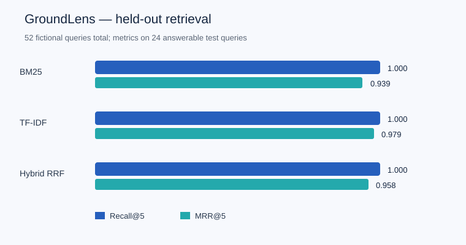

# GroundLens benchmark report

Held-out evaluation on synthetic fictional documents, without LLM generation.

| Method | Recall@1 | Recall@5 | MRR@5 | Gold-source citations | False citations (unanswerable) |
|---|---:|---:|---:|---:|---:|
| BM25 | 0.917 | 1.000 | 0.939 | 0.792 | 0.000 |
| TF-IDF | 0.958 | 1.000 | 0.979 | 0.792 | 0.000 |
| RRF hybrid | 0.917 | 1.000 | 0.958 | 0.792 | 0.000 |

The 18-question development split selects the abstention threshold. The 34-question test split is separate. Test set contains 24 answerable and 10 unanswerable questions. Zero observed failures on 10 unanswerable questions does not provide reliable guarantees.

**Negative result:** Hybrid retrieval did not beat standalone TF-IDF on this dataset.

